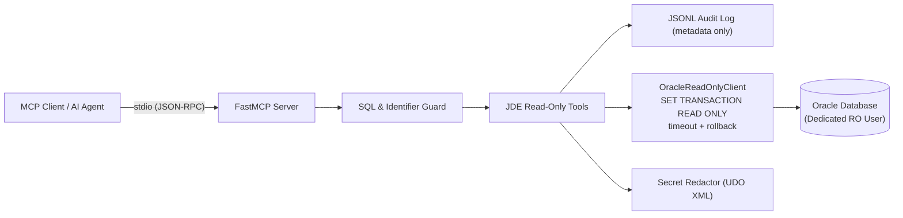

# jde-readonly-mcp

Read-only [Model Context Protocol (MCP)](https://modelcontextprotocol.io/) server for inspecting **JD Edwards EnterpriseOne** schemas, tables, and User Defined Object (UDO) definitions on Oracle Database.

Designed for legacy ERP discovery and operations support where AI agents need structured read access without risking production mutations.

## Architecture



## Available Tools (v1)

| Tool | Purpose | Safeguards |
| --- | --- | --- |
| `query` | Run a single read-only `SELECT` or `WITH` statement, returning TSV output. | SQL AST/token guard, row cap (`default=200`, `max=2000`), `SET TRANSACTION READ ONLY`, forced `ROLLBACK`, call timeout. |
| `describe_table` | Inspect columns, Oracle data types, nullability, and comments from `ALL_TAB_COLUMNS` / `ALL_COL_COMMENTS`. | Identifier validation, schema allow-list, bind variables only. |
| `list_tables` | Discover accessible tables in a schema using an optional `LIKE` pattern. | Identifier validation, schema allow-list, bind variables, row cap. |
| `get_udo_xml` | Fetch UDO XML metadata (for example orchestrations) from the configured UDO metadata table. | Identifier validation, schema allow-list, bind variables, automatic secret redaction on XML/JSON fields. |

## Defense-in-Depth Security Model

Application-level guards are never a substitute for database permissions. This server enforces multiple independent layers:

1. **SQL & identifier guard (`guard.py`)**: allows only single-statement `SELECT` or `WITH` queries; strips comments and string literals before scanning; blocks DML/DDL/DCL keywords, `FOR UPDATE` row locking, Oracle 12c+ inline PL/SQL (`WITH FUNCTION` / `WITH PROCEDURE`), and dangerous packages (`DBMS_*`, `UTL_*`, `OWA_*`, `CTX_DDL`, `HTTPURITYPE`).
2. **Database transaction guard (`oracle_client.py`)**: every execution runs inside an explicit `SET TRANSACTION READ ONLY` transaction, sets `call_timeout` (milliseconds), tags the Oracle session (`MODULE`, `ACTION`, `CLIENT_IDENTIFIER`), fetches at most `limit + 1` rows, and unconditionally executes `ROLLBACK` in `finally`.
3. **Schema allow-list (`config.py`)**: optional `JDE_ALLOWED_SCHEMAS` restricts metadata tools to explicitly approved schemas (for example `PRODDTA,PRODCTL,SY920`).
4. **Secret redaction (`redact.py`)**: masks likely password, token, API key, and private key values inside UDO XML/JSON payloads before returning them to the model.
5. **Metadata-only audit log (`audit.py`)**: appends structured JSONL entries (timestamp, tool, status, SQL, row count, duration) and never writes query result rows or credentials.

See [SECURITY.md](SECURITY.md) for the full threat model and a least-privilege Oracle account template.

## Installation

Requires Python 3.11+.

Install from PyPI:

```bash
pip install jde-readonly-mcp
# With OS credential store support (Windows Credential Manager, macOS Keychain, Linux Secret Service):
pip install "jde-readonly-mcp[keyring]"
```

Or install the latest version directly from GitHub:

```bash
pip install "git+https://github.com/jesusmendoza-dev/jde-readonly-mcp.git"
```

With OS credential store support:

```bash
pip install "jde-readonly-mcp[keyring] @ git+https://github.com/jesusmendoza-dev/jde-readonly-mcp.git"
```

Or install from a local clone:

```bash
git clone https://github.com/jesusmendoza-dev/jde-readonly-mcp.git
cd jde-readonly-mcp
pip install .
# With OS credential store support:
pip install ".[keyring]"
```

## Configuration

Configure the server through environment variables:

| Variable | Required | Default | Description |
| --- | --- | --- | --- |
| `JDE_DB_DSN` | Yes | - | Oracle Easy Connect DSN (e.g. `db-host.example.internal:1521/JDEPDB`). |
| `JDE_DB_USER` | Yes | - | Dedicated read-only Oracle user. |
| `JDE_DB_PASSWORD` | Conditional | - | Oracle password. Required unless `JDE_KEYRING_SERVICE` is set. |
| `JDE_KEYRING_SERVICE` | Conditional | - | Keyring service name used to resolve the password for `JDE_DB_USER`. |
| `JDE_DEFAULT_SCHEMA` | No | - | Default schema for metadata tools (e.g. `PRODDTA`). |
| `JDE_ALLOWED_SCHEMAS` | No | (unrestricted) | Comma-separated schema allow-list (e.g. `PRODDTA,PRODCTL,SY920,DD920`). |
| `JDE_DEFAULT_ROWS` | No | `200` | Default row limit for `query`. |
| `JDE_MAX_ROWS` | No | `2000` | Hard upper bound on rows returned per call. |
| `JDE_QUERY_TIMEOUT_SEC` | No | `120` | Oracle call timeout in seconds. |
| `JDE_CLIENT_TAG` | No | `jde-readonly-mcp` | Session tag written to Oracle `MODULE` and `CLIENT_IDENTIFIER`. |
| `JDE_AUDIT_LOG_PATH` | No | (disabled) | Path to append-only JSONL audit log (e.g. `./audit/queries.jsonl`). |
| `JDE_UDO_TABLE` | No | `F98220` | UDO metadata table name used by `get_udo_xml`. |

### Example MCP Client Configuration

```json
{
  "mcpServers": {
    "jde-readonly": {
      "command": "jde-readonly-mcp",
      "env": {
        "JDE_DB_DSN": "db-host.example.internal:1521/JDEPDB",
        "JDE_DB_USER": "JDE_RO_AGENT",
        "JDE_KEYRING_SERVICE": "jde-readonly-mcp",
        "JDE_DEFAULT_SCHEMA": "PRODDTA",
        "JDE_ALLOWED_SCHEMAS": "PRODDTA,PRODCTL,SY920,DD920",
        "JDE_AUDIT_LOG_PATH": "./audit/queries.jsonl"
      }
    }
  }
}
```

## Testing

For local development, install in editable mode with test dependencies:

```bash
pip install -e ".[dev]"
```

Unit tests run without an Oracle instance using fake database clients and temporary audit files:

```bash
PYTHONPATH=src python -m unittest discover -s tests -v
```

Or with pytest:

```bash
pytest -v
```

## Roadmap

- **v1 (current)**: Oracle read-only query, schema/table discovery, UDO XML inspection with secret redaction, SQL guards, JSONL audit logging, and unit test suite.
- **v2 (planned)**: Read-only JD Edwards AIS / Orchestrator REST discovery tools (allow-listed `BROWSE` / `COUNT` / scheduler inspection endpoints over HTTPS, with no orchestration execution).

## License

MIT. See [LICENSE](LICENSE).
